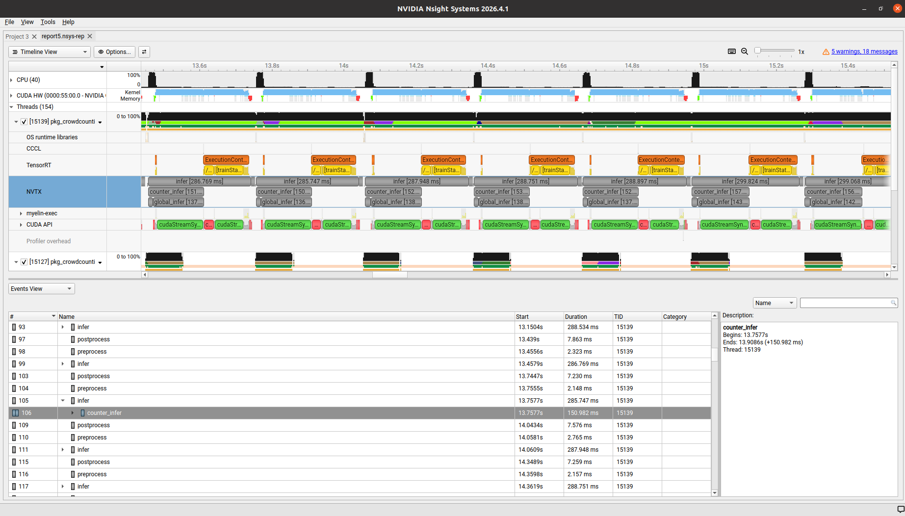

//Description: 使用Nsight Systems作性能分析的一些笔记

//Create Date: 2026-09-09 11:47:39

//Author: channy

# 概述 
性能分析的工具, windows下有Microsoft的Visual Studio, linux下有NVIDIA的Nsight Systems / Nsight Compute. 功能都非常强大.


# 背景
硬件:　GPU 是　NVIDIA　的　RTX 3090,　24G显存  
软件:　系统是Linux 20.04, CUDA 12.8, TensorRT 11.2

#　一些优化笔记
## copy过程中考虑数据存储的连续性
50ms 原始版
```c++
void GlobalCounter::precomputeLUT() {
    for (int c = 0; c < 3; ++c) {
        for (int v = 0; v < 256; ++v) {
            mLUT[c][v] = (v / 255.0f - mMean[c]) / mStd[c];
        }
    }
}
......

    // [batch_size, 3, h, w]
    const int planeHW = nInputH * nInputW;
    const int planeSize = nInputC * planeHW;

    const cv::Mat* imgs[2] = {&cvPad1, &cvPad2};
    for (int b = 0; b < 2; ++b) {
        cv::split(*imgs[b], mSplitCh[b]);

        float* dst = hostDataBuffer + b * planeSize;
        for (int c = 0; c < nInputC; ++c) {
            const uchar* src = mSplitCh[b][2 - c].data;
            float* dplane = dst + c * planeHW;
            const float* lut = mLUT[c];
#ifdef _OPENMP
#pragma omp parallel for schedule(static)
#endif
            for (int i = 0; i < planeHW; ++i) {
                dplane[i] = lut[src[i]];
            }
        }
    }
```
13ms 优化版
```c++
......
    const int planeHW   = nInputH * nInputW;    // 单通道元素数
    const int planeSize = nInputC * planeHW;

    const float invStd[3] = {static_cast<float>(1.0 / mStd[0]),
                             static_cast<float>(1.0 / mStd[1]),
                             static_cast<float>(1.0 / mStd[2])};
    const float bias[3]   = {static_cast<float>(-mMean[0] / mStd[0]),
                             static_cast<float>(-mMean[1] / mStd[1]),
                             static_cast<float>(-mMean[2] / mStd[2])};

    const cv::Mat* imgs[2] = {&cvPad1, &cvPad2};
    for (int b = 0; b < 2; ++b) {
        const uchar* srcBase = img.data;
        const size_t srcStep = img.step;
        float* dst = hostDataBuffer + b * planeSize;

#ifdef _OPENMP
#pragma omp parallel for schedule(static)
#endif
        for (int r = 0; r < nInputH; ++r) {
            const uchar* ps = srcBase + (size_t)r * srcStep;
            float* pR = dst + (size_t)r * nInputW;              
            float* pG = dst + planeHW + (size_t)r * nInputW;   
            float* pB = dst + 2 * planeHW + (size_t)r * nInputW; 
            for (int c = 0; c < nInputW; ++c) {
                const int off = c * 3;                 
                pR[c] = static_cast<float>(ps[off + 2]) * invStd[0] + bias[0];
                pG[c] = static_cast<float>(ps[off + 1]) * invStd[1] + bias[1];
                pB[c] = static_cast<float>(ps[off + 0]) * invStd[2] + bias[2];
            }
        }
    }

    return true;
}
```
然而,这两段代码都是AI给出的,第一段是在没有使用Nsight之前,让AI"把cv::Mat图像copy到TensorRT的buffer中,要快",AI给出了提前算mLUT的方案,说每个像素0-255归一化共256种情况,提前算划算;第二段是使用了Nsight后,发现前一段耗时有点多,让AI"分析该段代码耗时约50ms的原因,并给出优化",AI又说mLUT提前算取的时候不是连续取太耗时......

## 提前过滤检测框
检测后处理中, 原始版18ms
```c++
float confidence = sigmoid(obj_conf) * maxProb;
if (confidence >= m_fConfThres) ...
```
对置信度的过滤可以先过滤sigmoid(obj_conf) < m_fConfThres, 优化版1ms
```c++
    const float objLogitThr = -logf(1.0f / m_fConfThres - 1.0f);
	if (obj_conf < objLogitThr) continue;
```
因为原始的大多数检测框都属于背景,在置信度阈值高的时候尤其如此.

##　omp对小量数据反而是负优化　
8ms 原始版, 预估　mDetections.size() < 100
```c++
    #pragma omp parallel for
    for (size_t i = 0; i < mDetections.size(); ++i) {
        matDetections(i, 0) = (mDetections[i].xmin - pad_left) * scale_inv;
        matDetections(i, 1) = (mDetections[i].ymin - pad_top) * scale_inv;
        matDetections(i, 2) = (mDetections[i].xmax - pad_left) * scale_inv;
        matDetections(i, 3) = (mDetections[i].ymax - pad_top) * scale_inv;
        matDetections(i, 4) = mDetections[i].confidence;
        matDetections(i, 5) = mDetections[i].class_id;
    }
```
去掉omp后立即掉到<0.1ms
```c++
#pragma omp parallel for if (mDetections.size() > 1024)
```